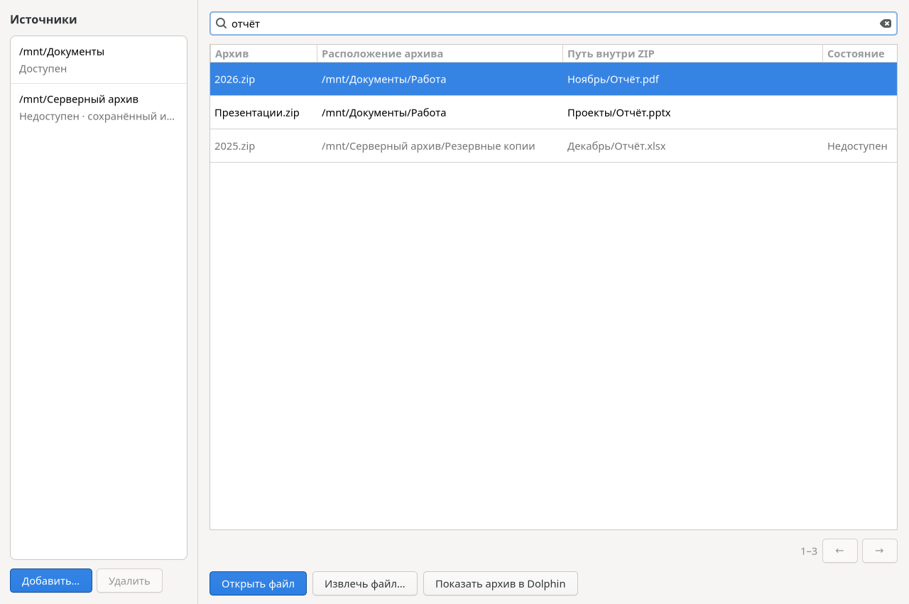

# Archive Scout

Archive Scout ищет файлы по имени и пути внутри ZIP-архивов на нескольких дисках и в папках одновременно. Приложение написано на Rust, использует GTK 4 и хранит индекс в SQLite.

## Установка

Скачайте пакет `Archive-Scout-*-x86_64.flatpak` со страницы [Releases](https://github.com/skyarse/Archive-Scout/releases), откройте его в Discover и нажмите «Установить». Для обновления откройте в Discover пакет новой версии.

Целевая платформа — Fedora 44 x86_64, KDE Plasma 6.7 и Wayland. Пакет использует `org.gnome.Platform//50` из Flathub и Flatpak 1.17 или новее.

## Как пользоваться

1. Нажмите «Добавить…» и выберите папку или корень смонтированного диска. Для SMB/NFS укажите локальную точку монтирования, например `/mnt/архивы`. Вложенную точку монтирования добавьте отдельным источником.
2. Введите имя файла или часть пути внутри ZIP. Поиск игнорирует регистр и показывает архив, его расположение и путь найденного файла.
3. Выберите строку, чтобы показать ZIP в Dolphin, открыть временную копию выбранного файла или сохранить его в указанном месте.

Индекс обновляется при запуске, каждые две минуты при открытом окне и по кнопке «Обновить индекс». Для отключённого источника сохраняются результаты предыдущего сканирования с пометкой «Недоступен». После подключения обновите индекс, чтобы открыть или извлечь файл.

Flatpak читает источники в режиме только чтения. Место извлечения выбирается в системном диалоге. Поиск поддерживает ZIP. Извлечение защищённых паролем файлов и прямые адреса `smb://` выходят за рамки текущей версии.

## Лицензия

[GNU General Public License v3.0](LICENSE). GTK 4 распространяется по LGPL-2.1-or-later, SQLite — общественное достояние. Лицензии Rust-зависимостей указаны в метаданных соответствующих пакетов из `Cargo.lock`.
